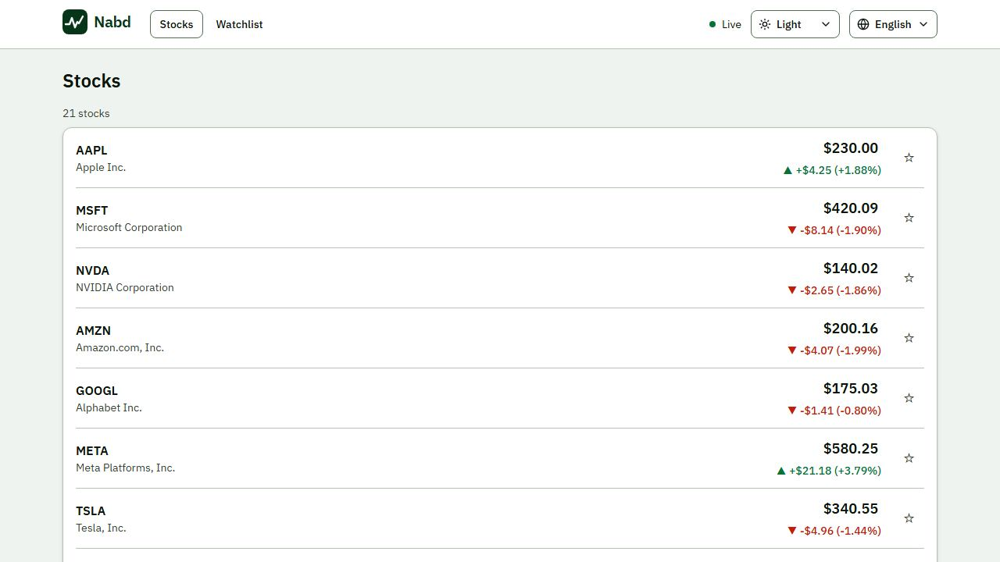
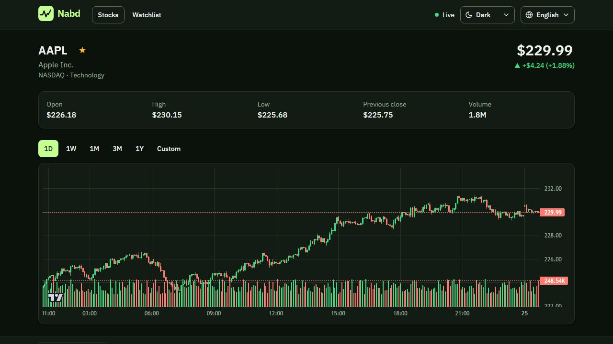
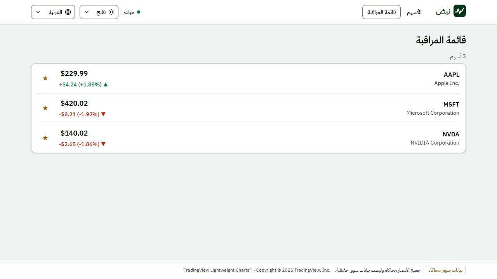
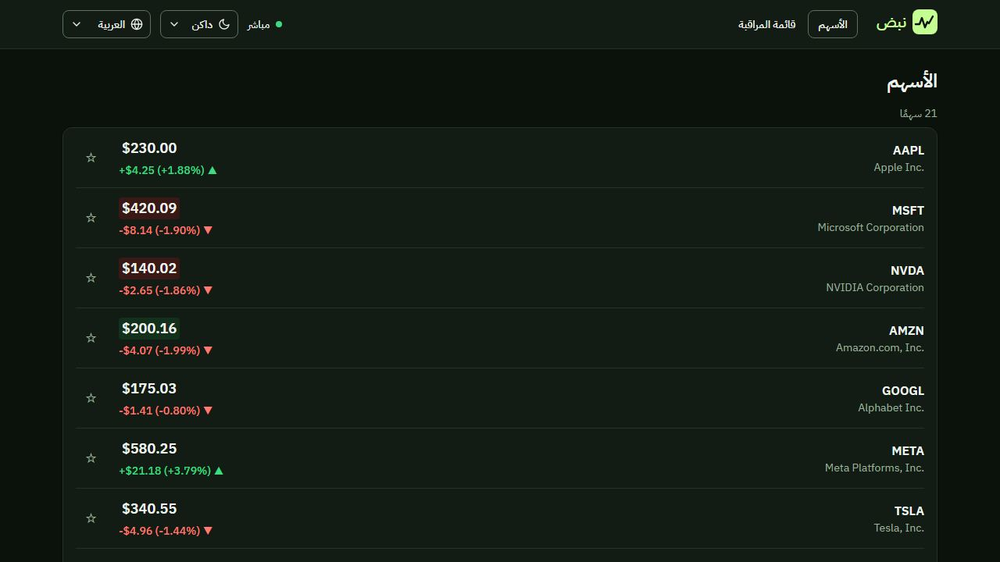
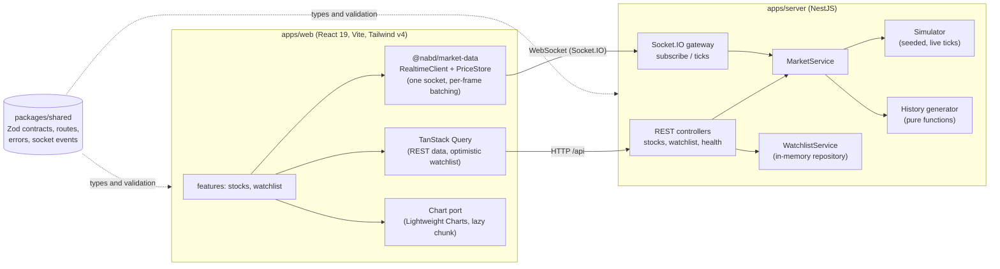

# Nabd (نبض)

**A mini trading app: a live stock list over WebSockets, stock pages with candlestick charts, and a watchlist. English and Arabic (RTL), light and dark.**

- **Live demo:** https://nabd-trading.vercel.app
- **API health:** https://nabdserver-production-5845f39b.up.railway.app/api/health

> Nabd is an independent project. It is not affiliated with any company or trading product, and **all market data is simulated**: the tickers are real, the prices are made up by a seeded simulator, and the app says so on every page.

| Stock list (light, English)                                     | Stock page with chart (dark, English)                        |
| --------------------------------------------------------------- | ------------------------------------------------------------ |
|              |             |
| **Watchlist (light, Arabic, right to left)**                    | **Stock list (dark, Arabic)**                                |
|  |  |

All twelve screenshots (three pages, two themes, two languages) are in [`docs/screenshots`](docs/screenshots) and are regenerated with `pnpm --filter @nabd/web screenshots`.

## Quick start

Requirements: **Node 24.13** (see `.nvmrc`) and **pnpm 12.23** (`corepack enable` provides the pinned version).

```sh
corepack enable
pnpm install
pnpm dev
```

Open http://localhost:5173. The web app runs on 5173 and the API on 3000. Every environment variable has a default, so nothing needs configuring (see [Configuration](#configuration)).

To run the browser tests once: `pnpm --filter @nabd/web exec playwright install chromium`, then `pnpm test:e2e`.

## Scripts

Run from the repository root; Turborepo runs each across the workspaces.

| Script                                    | What it does                                                                     |
| ----------------------------------------- | -------------------------------------------------------------------------------- |
| `pnpm dev`                                | Web (Vite) and API (Nest, watch mode) together                                   |
| `pnpm build`                              | Build every workspace (the shared package first)                                 |
| `pnpm lint`                               | ESLint in each workspace and at the root, plus Stylelint for CSS                 |
| `pnpm typecheck`                          | TypeScript in each workspace                                                     |
| `pnpm test`                               | Vitest with coverage thresholds in each workspace                                |
| `pnpm test:e2e`                           | Playwright against the real built server and web app (ports 3300 and 4273)       |
| `pnpm format` / `pnpm format:check`       | Prettier write / check                                                           |
| `pnpm --filter @nabd/web screenshots`     | Regenerate the README screenshots into `docs/screenshots`                        |
| `pnpm --filter @nabd/tokens run generate` | Rewrite the web `tokens.css` from the typed tokens (a test fails if it is stale) |

## Architecture



The web app and the server share code only through `packages/shared`: every request, response, error and socket event is a Zod schema there, and both sides derive their types from it.

### Folder structure

```
apps/web                 React app (Vite, Tailwind v4, TanStack Query, React Router, i18next)
  src/app                  layout (shell, header, footer), providers, routes and pages
  src/features             stocks (list, detail, chart), watchlist
  src/lib                  the browser parts: connectivity, client ID, language store, theme
  src/shared/ui            small shared components, one folder each with its test
  src/styles               design tokens (the only file with color literals) and base styles
  src/test                 test harness: providers around the shared fakes, the fake chart
  e2e                      Playwright specs (main flow, states, accessibility, keyboard, Arabic)
  screenshots              the script that generates docs/screenshots
apps/mobile              Expo app (SDK 58, Expo Router, jest-expo); the stock list, watchlist, stock detail and chart (milestones M0 to M3 of docs/MOBILE-PLAN.md; polish and release are M4 and M5)
apps/server              NestJS API and Socket.IO gateway
  src/modules/market       the simulator, the history generator, the stock universe, the market service
  src/modules/stocks       REST: list (paged, filtered), one stock, history
  src/modules/watchlist    REST: per-client watchlist behind a repository interface
  src/modules/realtime     the Socket.IO gateway and the tick batcher
  src/modules/identity     the anonymous client ID guard
  src/modules/chaos        optional injected latency and 503s for testing error states
  src/modules/health       liveness
packages/shared          Zod contracts, routes, error codes, socket events (compiled ESM)
packages/api-client      the HTTP client and endpoints, with every response validated (shared with mobile)
packages/domain          candle math, the chart summary, custom range validation (pure)
packages/market-data     the price store, the realtime client over Socket.IO, staleness, React bindings
packages/data            query keys, stock, history and watchlist hooks, optimistic updates
packages/i18n            English and Arabic resources, language rules, formatters
packages/tokens          design tokens as typed values, and the generator of the web tokens.css
packages/testing         recorders, fakes, fixtures and mock API handlers for Vitest and Jest
packages/config          shared tsconfig, ESLint, Prettier and Stylelint configs
docs/                    PLAN.md, decisions (ADRs), testing (test matrices), ai, screenshots, deployment
tasks/                   the plan and task list of the latest phase
.claude/commands         project commands for the AI agent (see docs/ai)
```

## Key decisions and trade-offs

Each is a short ADR with the alternatives that were rejected. The index is [`docs/decisions`](docs/decisions/README.md).

- **Live prices live outside React Query.** They sit in an external store read with `useSyncExternalStore`, batched once per animation frame, over a single ref-counted socket, so a tick re-renders only the rows of that symbol. No Redux. [ADR 0005](docs/decisions/0005-no-redux-live-prices-in-external-store.md)
- **The market is simulated, deterministically.** Seeded randomness, correlated moves and volatility clustering for live prices, and history as pure functions of the current price, so a candle is the same whichever request asks for it. The market is always open, so the demo never shows an empty chart. [ADR 0004](docs/decisions/0004-market-simulation-design.md)
- **The watchlist is in memory behind a repository interface.** A database would dwarf a take-home; swapping one in means writing one class. The price is that it resets on restart and the server runs a single instance. [ADR 0003](docs/decisions/0003-in-memory-watchlist.md)
- **The chart sits behind a port** (`ChartPort`), loaded on demand, so it is testable without a canvas and out of the main bundle; features compose through slots, never through each other's internals. [ADR 0007](docs/decisions/0007-chart-behind-a-port-and-feature-composition.md)
- **Semantic design tokens only.** The default Tailwind palette is removed, so a raw color cannot be written; light and dark swap one layer. A test checks WCAG contrast for every text and background pair. [ADR 0006](docs/decisions/0006-design-tokens-and-theming.md)
- **A paged list and a custom date range,** with server-side cursors and candle sizes chosen from the span. [ADR 0008](docs/decisions/0008-paged-stock-list-and-custom-history-range.md)
- **Route splitting was tried, measured and dropped;** stable dependencies got their own chunks for caching instead. [ADR 0009](docs/decisions/0009-route-splitting-measured-and-not-kept.md)
- **Vitest on the server, not Jest** (Nest 12 is ESM-only), and **three tools held below their latest major** until their lint plugins catch up. [ADR 0002](docs/decisions/0002-server-tests-with-vitest.md), [ADR 0001](docs/decisions/0001-toolchain-version-holds.md)

## Testing

| Layer          | What runs                                                                                                                                                   | Where                  |
| -------------- | ----------------------------------------------------------------------------------------------------------------------------------------------------------- | ---------------------- |
| Contracts      | Vitest on every Zod schema, route, error and socket event                                                                                                   | `packages/shared`      |
| Server         | Vitest with SWC: unit tests for the simulator, history, pagination and watchlist; supertest and socket tests for the API and the gateway                    | `apps/server`          |
| Web logic      | Vitest: stores, the realtime client, formatters, query hooks (with MSW), themes, i18n                                                                       | `apps/web/src`         |
| Web components | Vitest and Testing Library in jsdom, with a fake socket, a fake API and a fake chart                                                                        | next to each component |
| End to end     | Playwright, Chromium, against the real built server and web app: main flow, error and offline states, reduced motion, 320 px, Arabic and RTL, keyboard, axe | `apps/web/e2e`         |

- Run everything: `pnpm test`; one workspace: `pnpm --filter @nabd/web test` (or `@nabd/server`, `@nabd/shared`); browser tests: `pnpm test:e2e`.
- **Matrices first.** Every module has a test matrix in [`docs/testing`](docs/testing) written before its code; test names carry the row IDs (`LST-07`, `CHT-18`).
- **Coverage thresholds** are enforced in each Vitest config and never lowered: 90% overall, **100% on domain logic** (the simulator and history generator, the watchlist service, the price store and realtime client, the formatters, the API client). Bootstrap files are excluded explicitly with a reason.
- **Tests must be able to fail.** New checks were run against a deliberately broken version first (a removed focus ring, a mis-aligned value, a plain `span` instead of `bdi`); see [`docs/ai/lessons.md`](docs/ai/lessons.md).
- Counts at the last full run, made on a fresh clone: **1,096 unit and component tests** (170 contracts, 307 server, 255 web, and 364 in the shared packages) and **38 browser tests**.

## Quality gates

Rules live in tooling, so a change that breaks them is rejected instead of argued about.

| Gate                      | What it prevents                                                                                                                                                       |
| ------------------------- | ---------------------------------------------------------------------------------------------------------------------------------------------------------------------- |
| Prettier                  | Style discussions; also sorts Tailwind classes                                                                                                                         |
| TypeScript                | Loose types: `strict`, `noUncheckedIndexedAccess`, `exactOptionalPropertyTypes`, `noImplicitReturns`                                                                   |
| ESLint boundaries         | Web imports run `app → features → shared/lib` only; a feature never reaches into another's internals; server modules talk only through exported providers              |
| ESLint restricted imports | `socket.io-client` only in `@nabd/market-data`, `fetch` only in `@nabd/api-client`, `lightweight-charts` only in the chart adapter                                     |
| ESLint design system      | No unknown Tailwind classes, no arbitrary values, no color literals, **logical properties only** (`ms-`, `pe-`, `start-`; never `ml-`, `left-`), so RTL cannot regress |
| ESLint i18n               | Literal user-facing strings in JSX                                                                                                                                     |
| ESLint a11y and React     | `jsx-a11y`, hooks rules, `button-has-type`, leaked renders                                                                                                             |
| File naming               | Anything but kebab-case, for every file and folder                                                                                                                     |
| Stylelint                 | Color literals outside the tokens file, physical CSS properties, bad custom property names                                                                             |
| Git hooks                 | Pre-commit: format and lint on staged files. commit-msg: Conventional Commits. Pre-push: typecheck and tests                                                           |
| CI                        | All of it again on a clean Linux machine with a frozen-lockfile install, plus the end-to-end suite, because hooks can be skipped and CI cannot                         |

`--max-warnings 0` everywhere. Inline `eslint-disable` comments are ignored by configuration, and `--no-verify`, `@ts-ignore` and lowered coverage thresholds are not used.

## Accessibility, i18n and theming

- **Accessibility.** axe (WCAG 2.2 A and AA) runs over every page, in both themes and both languages, and found two real bugs that were fixed rather than excluded. The keyboard pass is automated (skip link first, a name and a focus ring at every stop, no trap). Live prices never go into a live region, so a screen reader is not flooded. The chart has a text description (period, change, start, end, high, low). Reduced motion switches animations off, and every page fits a 320 px screen. Details and the limits of what was checked: [`docs/testing/web-a11y.md`](docs/testing/web-a11y.md).
- **English and Arabic, right to left.** Typed resources for both languages; direction and `lang` follow the choice and survive a reload. Digits are Latin in both languages and numbers stay left to right inside RTL text; the chart's time axis speaks the language with Latin digits (`ar-u-nu-latn`); English names are isolated with `<bdi>` so they keep their order inside Arabic text.
- **Theming.** Light, dark or system, chosen in the header and applied before first paint so there is no flash. Colors come from semantic tokens only; up and down are always shown with a sign or arrow as well as color.

## Configuration

Both apps validate their environment with Zod at startup and refuse to run on invalid values. Every variable has a default.

| Variable                               | App    | Default                 | Meaning                                                                   |
| -------------------------------------- | ------ | ----------------------- | ------------------------------------------------------------------------- |
| `PORT`                                 | server | `3000`                  | HTTP and Socket.IO port                                                   |
| `CORS_ORIGIN`                          | server | `http://localhost:5173` | The one allowed web origin (HTTP and Socket.IO)                           |
| `MARKET_SEED`                          | server | `nabd`                  | Seed of the simulator                                                     |
| `SIM_VOLATILITY_SCALE`                 | server | `3`                     | Livelier than a real day, so the demo moves                               |
| `SIM_STEP_MS`                          | server | `100`                   | Simulator step                                                            |
| `TICK_FLUSH_MS`                        | server | `250`                   | How often ticks are batched to clients                                    |
| `CHAOS_LATENCY_MS`, `CHAOS_ERROR_RATE` | server | `0`, `0`                | Injected latency and 503s, to try the error states by hand                |
| `VITE_API_URL`                         | web    | `http://localhost:3000` | The API's full URL, with `https://` in production; baked in at build time |

Set them in `.env` files, not in your shell: copy `apps/server/.env.example` to `apps/server/.env` and `apps/web/.env.example` to `apps/web/.env.local`. Turborepo only passes the variables it declares to a task, so exporting `PORT` before `pnpm dev` does not reach the apps. If port 5173 is busy, Vite takes the next one and the API will reject that origin until `CORS_ORIGIN` in `apps/server/.env` matches it.

### API

Everything is under `/api`, speaks the contracts in `@nabd/shared`, and answers `{ data }` or `{ error: { code, message, details? } }`.

| Method and path                                                | What it does                                                                                             |
| -------------------------------------------------------------- | -------------------------------------------------------------------------------------------------------- |
| `GET /api/health`                                              | Liveness and uptime                                                                                      |
| `GET /api/stocks?limit&cursor&symbols`                         | Stocks with their quote; paged by cursor or filtered by `symbols`; `total` and `nextCursor` come back    |
| `GET /api/stocks/:symbol`                                      | One stock (404 if unknown)                                                                               |
| `GET /api/stocks/:symbol/history?period=` or `?from=&to=`      | Candles for `1D`, `1W`, `1M`, `3M`, `1Y`, or a custom range (1 hour to 1 year, ending no later than now) |
| `GET /api/watchlist`                                           | The caller's watchlist, in the order added                                                               |
| `PUT /api/watchlist/:symbol` / `DELETE /api/watchlist/:symbol` | Add (idempotent) / remove (idempotent, 204)                                                              |

Watchlist routes need an anonymous client ID in the `x-client-id` header (a UUID the browser generates once): identification, not authentication. Realtime is Socket.IO on the same port: a client sends `subscribe` or `unsubscribe` with `{ symbols }` and receives batched `ticks`; failures arrive as `server:error` with the same error shape.

## Deployment

The web app is on **Vercel** and the API on **Railway**, both deploying from `main`. The settings that work, and the two ways the first deploy failed, are in [`docs/deployment.md`](docs/deployment.md). In short:

- **Vercel:** root directory `apps/web` (build, output and routing from `apps/web/vercel.json`); env `VITE_API_URL` = the API's URL with `https://`.
- **Railway:** build command `pnpm turbo run build --filter=@nabd/server`, health check `/api/health`; env `NODE_ENV=production` and `CORS_ORIGIN` = the Vercel URL. One replica.

## Known limitations

- **Simulated data.** Prices are an approximate snapshot with a random walk on top, the market never closes, and history is relative to the current price, so a past close is not stable (ADR 0004).
- **The watchlist is in memory.** It is lost when the server restarts or redeploys, and the server cannot run more than one instance, because a second one would hold different prices and different watchlists (ADR 0003). Memory is bounded (10 000 clients, least recently used evicted).
- **No authentication.** The client ID identifies a browser, nothing more. There is no rate limiting.
- **One allowed web origin.** `CORS_ORIGIN` takes a single URL, so Vercel preview deployments cannot call the API.
- **A bad configuration shows a blank page.** The app refuses to start on an invalid `VITE_API_URL` (good) but does not say so on screen (not good); the error is only in the console.
- **Accessibility is checked by tools, not by people.** axe and the keyboard spec read the accessibility tree in Chromium; no real screen reader was run. The Arabic text was reviewed by the project author but has not had a professional localization review.
- **The hosted API runs on a Railway trial** that lasts until late December 2026. After that the live API may be offline; everything still runs locally with `pnpm dev`.
- **`SIGTERM` does not trigger Nest's shutdown hooks on Windows.** A Node limitation on that platform.
- **The chart attribution** follows the library's notice (its logo is on and a link is in the footer); that is a reading of the notice, not legal advice.
- **The mobile app has no custom date range.** The chart offers the five periods (1D, 1W, 1M, 3M, 1Y); the web app also has a custom range (ADR 0008).
- **The mobile app has only been run on one Android phone, in Expo Go.** iOS has not been run, there is no store build yet, and no real screen reader was used on mobile. The Android package id `com.nabd.trading` is an assumption until a store listing exists.
- **The mobile chart is a WebView** (ADR 0013), which a screen reader cannot read; the numbers behind it are shown as text beneath it. Only the chart page loads, and links in it are not followed.
- **The Arabic text in the mobile app** reuses the web strings, plus the ones M3 added, and has not had a professional localization review.

## What I would do next

- **A mobile app** (Expo or React Native) on the same `@nabd/shared` contracts and the same REST and Socket.IO API: the contracts, the tick format and the price-store design carry over; only the UI changes.
- **Real accounts** (OAuth or passwords with sessions) in place of the anonymous client ID, so a watchlist follows a person across devices.
- **Persistence:** Postgres behind the existing `WatchlistRepository` interface, which also removes the single-replica limit for watchlists.
- **A real market data provider** behind the `MarketService` interface, with its licensing, rate limits and a cache; the simulator stays as the offline and test implementation.
- **Scaling the realtime layer:** a Socket.IO adapter (Redis) so several server instances share subscriptions and ticks.
- **Operations:** structured logs, metrics and alerts on the API, a rate limiter, and a readable "configuration error" screen on the web.
- **Quality:** a real screen reader pass, a professional Arabic localization review, visual regression tests for the four theme and language combinations, and E2E on Firefox and WebKit.
- **Features that fit the data:** price alerts, a portfolio with simulated orders, and a compare mode on the chart.

## How I worked with AI

Planned in Claude chat, built phase by phase in Claude Code under a written working agreement (`CLAUDE.md`), with the tooling rejecting what breaks the rules and every claim checked by a test, a measurement or a real browser. The honest account, including thirteen cases where the AI was wrong and how each was caught, is in [`docs/ai`](docs/ai/README.md).
